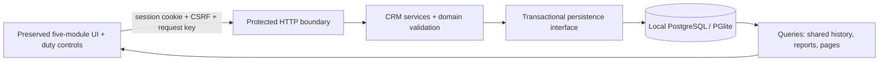

# Scope and evidence baseline — 20 October 2026

## Identity and source integrity

Product: Emerald Field Sales CRM, Emerald Interlink Trading L.L.C, UAE building-materials trading. The outer README/Project-Background and original requirements agree. This is separate from AquaFleet. The current user-supplied Codex brief establishes the developer role; the older supervisor prompt is background evidence only.

`Source.zip` was extracted under `reference/` without edits. Runtime HTML SHA-256: `150613e28fb7f83c8c5fa1e80458c258d0ddaf394cbd929d02e4fc516a903d48`. All ten entries in the supplied SHA256 manifest match (`evidence/integrity.json`). Git attributes preserve reference bytes on checkout. The original reference acceptance test is unchanged and was not executed; the new portable baseline harness avoids its stale portfolio/date assumptions.

Read: outer README and Project-Background; extracted original requirements, DEMO-INVENTORY, VALIDATION, provenance, and actual HTML. The separately mentioned client-requirements review, `Emerald_Client_Audio_Transcripts.txt` and the three recordings are absent from the supplied project/archive. The user's current brief supplies a reconciled interpretation. It is accepted as supplied evidence, not independently verified audio.

## Requirement-to-source matrix

| Requirement | Evidence classification / source | Local disposition |
| --- | --- | --- |
| Dashboard, Shops, Visits, Leads, Sales Team | Source-verified: HTML navItems/render functions, lines 68–108 | All five retained; server-backed reads and pagination |
| Shared shop history usable by next executive | Original requirements + actual shop profile/timeline | Authenticated organization-wide reads; tested across users and unassigned executive |
| Search → profile → check-in → checkout/notes/order interest/follow-up | Source-verified: HTML lines 109–122; original requirements | Implemented behind visit policy; isolated API/browser verification passed |
| Discovery/save/immediate visit | Source-verified: addShopForm/submitShop | Executive self-assigned lead capture; atomic save-and-check-in behind visit policy |
| Roughly 600–700 shops, three executives and a manager | Original business brief; demo has 36 synthetic shops | 700 synthetic shops, 3 executives, separate manager and admin accounts |
| Real sessions, protected reads/writes, audit and persistence | Current user request; source has none | Implemented; tested at HTTP and PostgreSQL boundaries |
| Duty start/end, rest departure/return | Audio-supported **as reported in current user brief** for recording 1, 00:00–00:17; raw audio absent | Separate state machine, server events, own controls and restricted history |
| Person-wise duty display / cut duty / exact late wording | Unresolved: user describes uncertain audio | Own history and manager visibility approved in this chat; peer visibility and corrections remain restricted |
| Usable user-side/mobile review | Recording 2 interpretation supplied by user | Populated executive browser/mobile checks executed; client UAT still pending |
| Client list and salesman setup before review/corrections | Recording 3 interpretation supplied by user | Synthetic roster, admin account API, safe import plan; no real list/import |
| Optional GPS at one check-in; denial does not block | Source-verified checkin() and inventory | One browser request; captured/denied/unavailable/timeout/not_requested stored honestly |
| UAE date reporting | Proposed in current brief; original mixes local and UTC dates | Asia/Dubai explicit; instants UTC, due dates DATE; midnight tested |
| Visit concurrency/follow-up ownership | Proposed; demo blocks one local shop only | Implemented approved-v1 candidate, operational writes pending user decision |
| Zoho Books boundary | Original requirements | No accounting features or integration |
| Supplied Emerald logo | User image attachment | Copied into development client; original demo remains unchanged |

## Module and data-flow map

`client/app.ts` owns rendering/forms/navigation and honest save errors. `src/domain.ts` owns validated inputs, UAE dates and transitions. `src/service.ts` owns capabilities, attribution, atomic workflows and queries. `src/auth.ts` owns password/session verification. `src/server.ts` is the HTTP/session/CSRF/static boundary. `src/database.ts` is the replaceable persistence adapter; versioned SQL lives in migrations. Synthetic fixtures are separate from schema and customer data.

## Reproduced baseline and deliberate behavior changes

Executed `scripts/baseline.mjs`: all five principal pages captured at 1440px; Al Noor's eight visits became nine through check-in/checkout; reload returned a populated dashboard; 390px shops had no page overflow; no page exceptions. Identity defect confirmed: selecting Naseer leaves stored `ahmed`. See `evidence/baseline.json` and `reference-*.png`.

Code inspection additionally confirms manager-to-Ahmed check-in attribution, checkout reassignment, inconsistent lead labels, localStorage-only persistence, device-clock trust, duplicate relationship fields, and a misleading active count. Those additional defects were not all separately exercised in the original browser.

Intentional UX changes: sign-in/name/sign-out replaces Viewing as and Reset demo; a separate duty card/history is added; database results paginate 40 rows; Refresh makes manager freshness explicit; activity counts are derived; the invented daily target of 12 is removed pending a business target; follow-ups are independent records with explicit actions; canonical shop status and assignment no longer change implicitly at checkout. Visit notes remain immutable after completion pending correction policy. Original navigation, page structure, labels, green palette, table/card adaptation and mobile bottom navigation are retained. No unsolicited redesign was performed.

## Scope limits

This is the first local foundation and reviewable vertical slice. Client acceptance, production authentication operations, customer imports, reassignment, lead conversion and audited visit correction UI are not complete. No real recordings, identities, customer data, accounting credentials, hosting or domain were supplied. No payroll/minimum-hours rule is inferred from speech.
